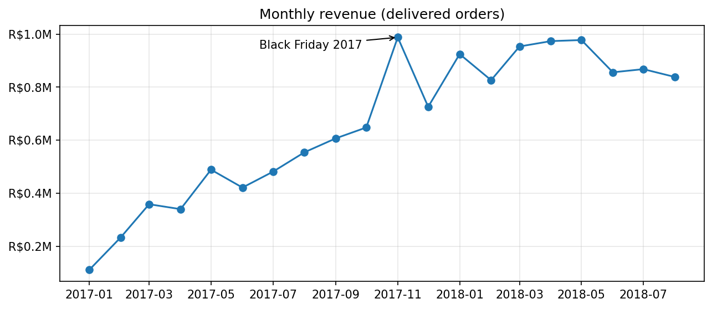
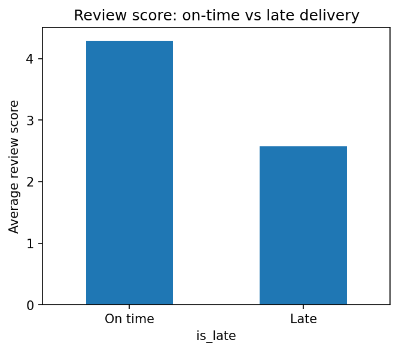
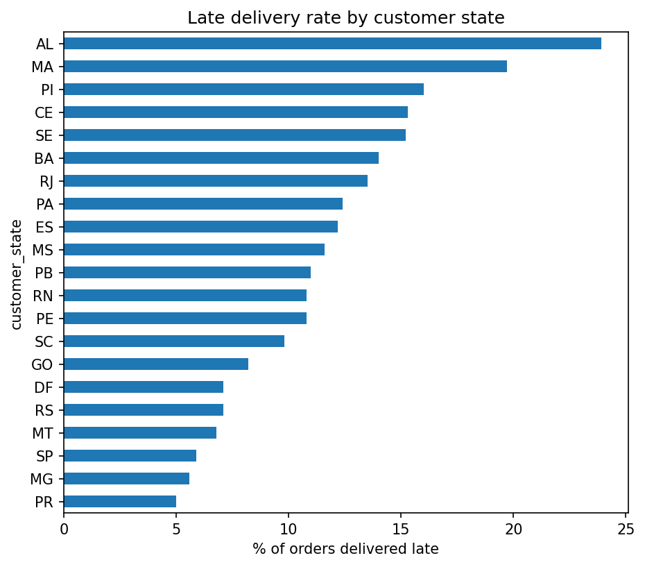
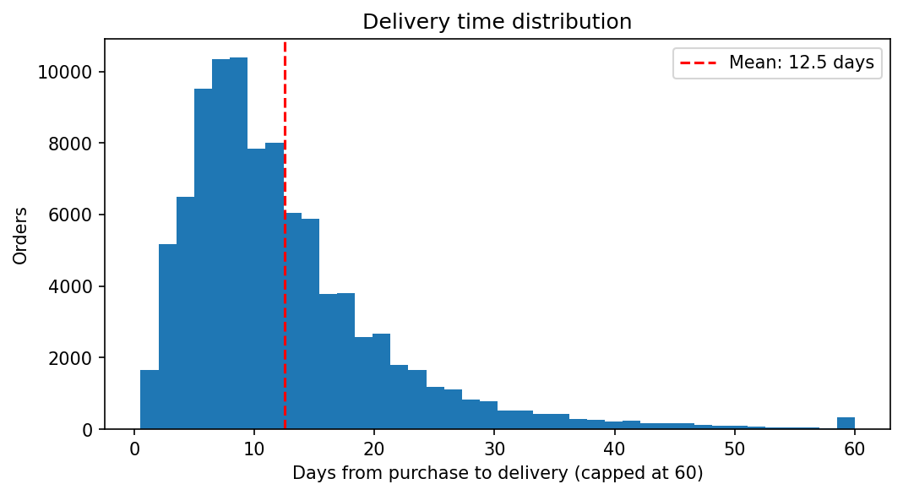

# Olist E-Commerce SQL Analysis

SQL analysis of ~100k orders from Olist, a Brazilian online marketplace (2016-2018). The database runs in Docker (PostgreSQL 16) and is queried with DBeaver. The goal is to answer real business questions about revenue, customers, delivery and satisfaction using joins, CTEs and window functions.

**Dataset:** [Brazilian E-Commerce Public Dataset by Olist](https://www.kaggle.com/datasets/olistbr/brazilian-ecommerce) (Kaggle)

## Tech

PostgreSQL 16 | Docker Compose | DBeaver | SQL (joins, CTEs, window functions, conditional aggregation) | Python (pandas, SQLAlchemy, matplotlib, Jupyter)

## How to reproduce

1. Download the 9 CSVs from Kaggle into a `data/` folder next to `docker-compose.yml`.
2. Start the database: `docker compose up -d` (Postgres is exposed on port 5433).
3. Connect in DBeaver: host `localhost`, port `5433`, database `olist_db`, user `olist_user`, password `olist_pass`.
4. Run `schema.sql` to create the 9 tables with keys and indexes.
5. Load each CSV into its table (DBeaver import, or `\copy` inside the container). Load parent tables first: customers, sellers, product_category_name_translation, products, then orders, then order_items, order_payments, order_reviews.
6. Run the files in `queries/`.

## Data model

`orders` is the centre of the schema. Customers place orders; `order_items` links each order to its products and sellers; payments and reviews attach to the order. `product_category_name_translation` maps Portuguese category names to English.

`customers -> orders -> order_items -> products / sellers`

## Metric definitions

- **Revenue** = sum of item `price` on orders with status `delivered` (freight excluded).
- **Unique customer** = `customer_unique_id`. `customer_id` is generated per order, so counting it would overstate customers.
- `order_items` and `order_payments` are never joined directly. Each is aggregated to one row per order first, otherwise rows multiply and revenue is inflated.

## Key findings

| Area | Finding |
|---|---|
| Overall | 96,478 delivered orders, 93,358 unique customers, R$13.22M product revenue, average order value R$137.04 |
| Growth | Strong growth through 2017 with a Black Friday spike in Nov 2017 (+52% vs Oct), then revenue plateaus at roughly R$850K-R$975K a month through 2018 |
| Categories | Top by revenue: health_beauty (R$1.23M), watches_gifts (R$1.17M), bed_bath_table (R$1.02M). `computers` has few orders (177) but high revenue per order |
| Geography | Sao Paulo state is about 38% of revenue; SP, RJ and MG together are about 63% |
| Delivery | Average delivery takes 12.6 days, about 11 days earlier than the estimate on average; 8.1% of orders arrive late |
| Satisfaction | office_furniture has the lowest review score (3.64) among categories with at least 100 reviewed orders, and it has high volume (1,244 reviewed orders) |
| Retention | Only 3.0% of customers (2,801) ordered more than once |
| Customer value | The top 25% of customers generate 62.5% of revenue; the bottom 25% generate 5.1% |
| Sellers | The top seller in Sao Paulo earned R$227K, and the top seller in Bahia earned R$218K, showing how concentrated sales are on a few sellers |

## Queries

| File | Question | Main SQL concepts |
|---|---|---|
| 01_overall_kpis.sql | Headline orders, customers, revenue, AOV | aggregation, COUNT DISTINCT |
| 02_monthly_revenue.sql | Revenue trend by month | DATE_TRUNC |
| 03_top_categories.sql | Top categories by revenue | multi-table joins, LEFT JOIN, COALESCE |
| 04_revenue_by_state.sql | Revenue by customer state | joins, GROUP BY |
| 05_mom_growth.sql | Month-over-month growth | CTE, LAG |
| 06_delivery_performance.sql | Delivery time and late orders | date arithmetic, FILTER |
| 07_review_by_category.sql | Review score by category | CTEs, HAVING |
| 08_repeat_customers.sql | Repeat customer rate | CTE, FILTER |
| 09_customer_tiers.sql | Spend tiers and revenue share | NTILE, window over aggregate |
| 10_top_seller_per_state.sql | Best seller in each state | RANK, PARTITION BY |

## Python analysis

The notebook `notebooks/olist_analysis.ipynb` connects to the same Postgres database with SQLAlchemy, pulls query results into pandas, and goes further than the SQL queries by testing why customers are unhappy.

### Does late delivery hurt reviews?

| | Orders | Avg review score |
|---|---|---|
| Delivered on time | 88,163 | 4.29 |
| Delivered late | 7,661 | 2.57 |

Late orders are only about 8% of the total, but they score 1.7 points lower. This is a strong association, not proof of cause: late orders may also differ in distance or product type.

### Where do late deliveries happen?

Late rates follow geography. The northeast is worst (Alagoas 23.9%, Maranhao 19.7%, Piaui 16.0%), and the south and southeast are best (Parana 5.0%, Minas Gerais 5.6%, Sao Paulo 5.9%). Rio de Janeiro has 12,350 orders at a 13.5% late rate, about 1,700 late orders, which is far more than the small high-rate states. The state to prioritise depends on volume times late rate, not the rate alone.

### Delivery time distribution

Delivery time peaks at roughly one week and has a long right tail. The mean is 12.5 days, pulled up by a minority of orders that take over a month (the last bar groups everything of 60 days or more).

### Case study: why is office_furniture rated lowest?

The SQL analysis found office_furniture has the lowest average review score (3.64). I tested whether delivery explains it:

- Its late rate is close to normal (9.2% vs 8.1% overall), but delivery takes **20.6 days on average** against 12.6 for all orders.
- Splitting orders by delivery time shows that office furniture scores lower than other categories even at the same speed:

| Delivery time | Other categories | office_furniture |
|---|---|---|
| Up to 10 days | 4.38 (46,569 orders) | 4.01 (179 orders) |
| 11-20 days | 4.22 (35,281 orders) | 3.83 (517 orders) |
| Over 20 days | 3.23 (13,522 orders) | 3.35 (548 orders) |

- 44% of office_furniture orders fall in the over-20-days group, against about 14% for other categories. Slow delivery therefore explains part of the gap, roughly 40% by my back-of-envelope reweighting of the table above, but not all of it. A gap of about 0.4 points remains at equal speed.
- The data cannot say what causes the remaining gap. Possible reasons (damage, assembly, product quality) would need review text or return data. The fast-delivery group is small (179 orders), so that row is less reliable.

## Data notes

- Data starts in Sep 2016 and ends in 2018, with very few orders in late 2016 and none in Nov 2016. Early and final months are not comparable with the rest.
- 8 delivered orders have no delivery date, so delivery metrics use 96,470 orders.
- Some products have no category; they are reported as `unknown`.
- Notebook analyses that involve review scores only cover delivered orders that have a review (95,824 orders), so figures such as the mean delivery time (12.5 days) differ slightly from the SQL version (12.6 days), which uses all delivered orders.
- DBeaver's CSV import stopped at 70,000 rows for `order_reviews` (multi-line comments). The table was reloaded with `\copy` to load all rows.
